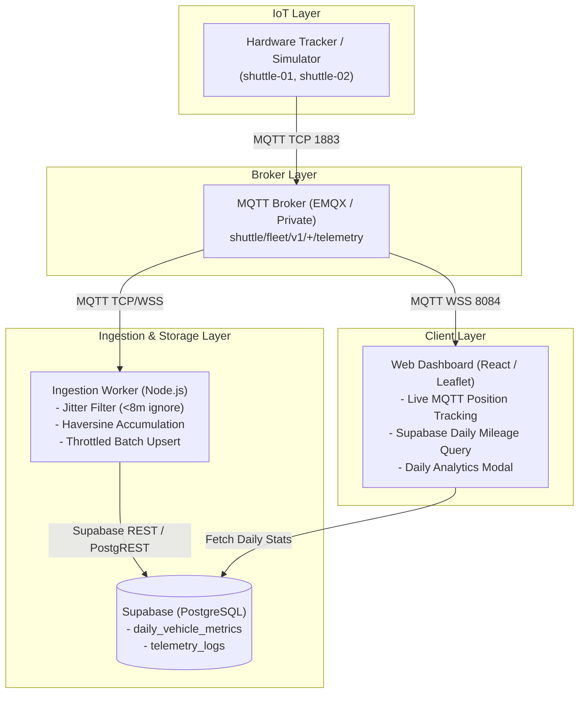

# Design Specification: Daily Distance Tracking & Telemetry Persistence

**Date:** 2026-10-21  
**Status:** Approved  
**Author:** Pair Programming Assistant & User  

---

## 1. Overview & Objective

To satisfy the requirements in `requirement.md` ("การวัดและสรุปผลระยะทาง: วัดระยะทางการเคลื่อนที่ของรถแต่ละคัน และนำมาแสดงผลรวมใน 1 วัน หรือต่อรอบการเดินทาง"), this feature introduces:
1. **Persistent Telemetry & Metrics Storage in Supabase (PostgreSQL):** Storing daily aggregated distance, operational time, and maximum speed for each vehicle.
2. **Background MQTT Ingestion Worker (`tools/worker.js`):** Subscribes to the MQTT broker, computes incremental distance using the Haversine formula with GPS jitter filtering, and batches upserts to Supabase.
3. **Frontend Daily Analytics & Distance Display:** Shows today's accumulated distance (`km`) on each vehicle card and provides a dedicated daily summary view.
4. **Resilient Offline / Demo Graceful Degradation:** If Supabase credentials are not yet configured, the frontend gracefully falls back to displaying real-time session distance calculated in-memory without throwing errors.

---

## 2. Architecture & Data Flow



---

## 3. Database Schema (Supabase / PostgreSQL)

### 3.1 Table: `daily_vehicle_metrics` (Aggregated Daily Rollup)

Stores pre-aggregated stats per vehicle per calendar date for fast, low-cost dashboard queries:

```sql
CREATE TABLE IF NOT EXISTS daily_vehicle_metrics (
    vehicle_id VARCHAR(64) NOT NULL,
    date DATE NOT NULL DEFAULT CURRENT_DATE,
    total_distance_km NUMERIC(8, 2) NOT NULL DEFAULT 0.00,
    max_speed_kmh NUMERIC(5, 2) NOT NULL DEFAULT 0.00,
    avg_speed_kmh NUMERIC(5, 2) NOT NULL DEFAULT 0.00,
    active_minutes INT NOT NULL DEFAULT 0,
    last_updated_at TIMESTAMPTZ NOT NULL DEFAULT NOW(),
    PRIMARY KEY (vehicle_id, date)
);

CREATE INDEX IF NOT EXISTS idx_daily_metrics_date ON daily_vehicle_metrics (date DESC);
```

### 3.2 Table: `telemetry_logs` (Breadcrumbs for Route Trail History)

Downsampled breadcrumb points recorded only when vehicle moves (> 15m or > 10s):

```sql
CREATE TABLE IF NOT EXISTS telemetry_logs (
    id BIGINT GENERATED ALWAYS AS IDENTITY PRIMARY KEY,
    vehicle_id VARCHAR(64) NOT NULL,
    lat DOUBLE PRECISION NOT NULL,
    lng DOUBLE PRECISION NOT NULL,
    speed NUMERIC(5, 2) NOT NULL DEFAULT 0.00,
    heading NUMERIC(5, 2) DEFAULT 0.00,
    recorded_at TIMESTAMPTZ NOT NULL,
    created_at TIMESTAMPTZ NOT NULL DEFAULT NOW()
);

CREATE INDEX IF NOT EXISTS idx_telemetry_logs_vehicle_time ON telemetry_logs (vehicle_id, recorded_at DESC);
```

### 3.3 Row Level Security (RLS) Policies

```sql
ALTER TABLE daily_vehicle_metrics ENABLE ROW LEVEL SECURITY;
ALTER TABLE telemetry_logs ENABLE ROW LEVEL SECURITY;

-- Allow public read access via Anon Key for dashboard viewing
CREATE POLICY "Public read daily_vehicle_metrics"
    ON daily_vehicle_metrics FOR SELECT USING (true);

CREATE POLICY "Public read telemetry_logs"
    ON telemetry_logs FOR SELECT USING (true);

-- Allow authenticated / service role insert & update
CREATE POLICY "Service write daily_vehicle_metrics"
    ON daily_vehicle_metrics FOR ALL
    USING (auth.role() = 'service_role' OR auth.role() = 'authenticated');

CREATE POLICY "Service write telemetry_logs"
    ON telemetry_logs FOR INSERT
    WITH CHECK (auth.role() = 'service_role' OR auth.role() = 'authenticated');
```

---

## 4. Ingestion Worker Specification (`tools/worker.js`)

- **MQTT Client:** Subscribes to `shuttle/fleet/v1/+/telemetry`.
- **Haversine Distance Calculator:**
  - Given previous point `(lat1, lng1)` and current point `(lat2, lng2)`:
    $$\Delta\sigma = 2 \arcsin \sqrt{\sin^2(\Delta\phi/2) + \cos\phi_1 \cos\phi_2 \sin^2(\Delta\lambda/2)}$$
    $$\text{distance} = R \cdot \Delta\sigma \quad (R = 6371 \text{ km})$$
- **Jitter Filter Rules:**
  - If calculated distance $< 0.008\text{ km}$ ($8$ meters) AND speed $< 1.5\text{ km/h}$, ignore increment (parked GPS noise).
  - If calculated speed between points $> 150\text{ km/h}$, flag as GPS teleport glitch and ignore.
- **Batching & Throttling:**
  - In-memory cache accumulates distance per vehicle.
  - Flushes upserts to `daily_vehicle_metrics` in Supabase every 5 seconds (or upon clean shutdown).
  - Downsamples breadcrumb insertion into `telemetry_logs` (every 10 seconds per vehicle or distance $> 20$m).

---

## 5. Frontend Architecture & UI Updates

### 5.1 Supabase Service Client (`frontend/src/services/supabaseClient.ts`)
- Configured via `VITE_SUPABASE_URL` and `VITE_SUPABASE_ANON_KEY`.
- If environment variables are omitted or blank, provides mock/fallback mode without throwing runtime errors.

### 5.2 Distance Query Hook (`frontend/src/hooks/useDailyMetrics.ts`)
- Queries `daily_vehicle_metrics` for today's date (`CURRENT_DATE`).
- Automatically refetches periodically (e.g. every 15 seconds) or subscribes to Supabase Realtime changes.
- In-memory fallback: calculates incremental session distance from live MQTT telemetry if database is not connected.

### 5.3 UI Components
1. **`FleetPanel.tsx` Enhancement:**
   - Under each vehicle card, adds a clean badge showing today's distance (e.g. `📍 24.5 km`).
2. **`DailyMetricsModal.tsx` Component:**
   - Button on header / fleet panel: "Daily Report / สรุปประจำวัน"
   - Modal dialog displaying:
     - Today's date selector.
     - Fleet Summary Cards: Total Fleet Distance, Total Running Hours, Active Shuttles.
     - Table of vehicles: Vehicle ID, Distance (km), Max Speed, Status.

---

## 6. Environment Variables

### In `tools/.env`:
```env
MQTT_BROKER=mqtt://broker.emqx.io:1883
SUPABASE_URL=https://your-project.supabase.co
SUPABASE_SERVICE_ROLE_KEY=your-supabase-service-role-key
```

### In `frontend/.env`:
```env
VITE_SUPABASE_URL=https://your-project.supabase.co
VITE_SUPABASE_ANON_KEY=your-supabase-anon-key
```

---

## 7. Verification & Testing Strategy

1. **Unit Tests:**
   - Haversine distance calculator unit tests (known distance between coordinates).
   - Jitter filter unit tests (discarding <8m stationary drift and >150km/h teleportation).
   - `useDailyMetrics` hook tests (successful query, mock fallback when unconfigured).
   - `DailyMetricsModal` UI rendering tests.
2. **Integration & Build:**
   - Full Vitest suite passing with 0 regressions.
   - Clean production build (`npm run build`).
3. **End-to-End Test:**
   - Run simulator (`npm run simulate`) alongside worker (`npm run worker`), verify distance increments steadily over time.
