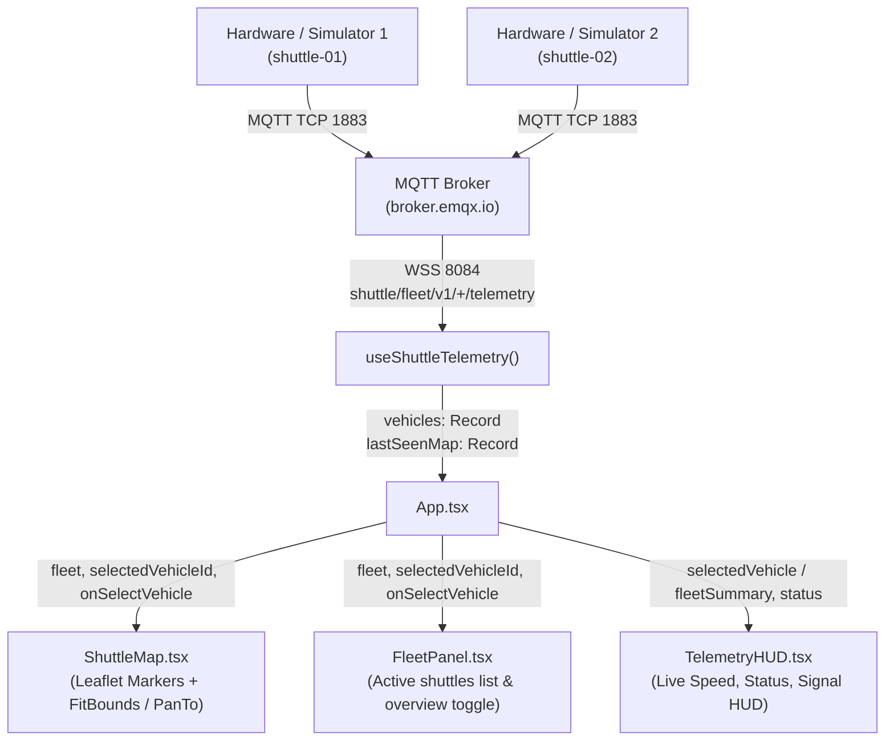

# Design Specification: Multi-Vehicle Fleet Tracking Dashboard

**Date:** 2026-10-21  
**Status:** Approved  
**Author:** Pair Programming Assistant & User  

---

## 1. Overview & Objective

The current dashboard only handles a single vehicle's telemetry stream (`TelemetryPayload | null`). When multiple hardware trackers publish to `shuttle/fleet/v1/+/telemetry`, incoming telemetry messages overwrite each other in state, causing the map camera and HUD indicators to erratically flicker and jump between vehicles.

This specification defines the multi-vehicle fleet tracking upgrade to:
1. Support an arbitrary number of concurrent vehicles in real-time.
2. Provide a **Fleet Overview** mode that fits the map viewport (`fitBounds`) to encompass all active shuttles simultaneously.
3. Allow users to select and focus on an individual shuttle (`panTo` follow camera) with a one-click option to return to the full fleet overview.
4. Display a minimal, elegant **Fleet Panel / Sidebar** listing all active vehicles, their connection/movement status, current speed, and last-seen indicator.

---

## 2. Architecture & Data Flow



---

## 3. Detailed Component & Service Specifications

### 3.1 Type Definitions (`frontend/src/types/telemetry.ts`)

Extend types to represent multi-vehicle state:

```typescript
export interface VehicleStatus {
  telemetry: TelemetryPayload;
  lastSeen: number;
  isOnline: boolean; // true if Date.now() - lastSeen < OFFLINE_THRESHOLD_MS (e.g., 15s)
}

export type FleetMap = Record<string, TelemetryPayload>;
export type FleetStatusMap = Record<string, VehicleStatus>;
```

### 3.2 Telemetry Hook (`frontend/src/hooks/useShuttleTelemetry.ts`)

- **State:**
  - `vehicles: FleetMap` (keyed by `vehicle_id`)
  - `lastSeenMap: Record<string, number>` (keyed by `vehicle_id`)
  - `selectedVehicleId: string | null` (defaults to `null` for Fleet Overview mode)
  - `status: ConnectionStatus` (MQTT broker connection status)
- **Message Handling:**
  - Upon receiving and parsing telemetry from `shuttle/fleet/v1/<id>/telemetry`:
    - Insert/update `vehicles[vehicle_id] = parsedPayload`
    - Update `lastSeenMap[vehicle_id] = Date.now()`
- **Selection Action:**
  - `setSelectedVehicleId(id: string | null)` exposed to allow switching focus or returning to overview.

### 3.3 Interactive Map (`frontend/src/components/ShuttleMap.tsx`)

- **Markers:**
  - Render a `<Marker>` for every vehicle in `vehicles`.
  - Vehicle icon retains directional rotation (`heading`) and adds a visible vehicle ID badge (e.g. `shuttle-01`).
  - Active/selected vehicle gets a distinct visual highlight ring (emerald glow).
  - Clicking a marker triggers `onSelectVehicle(vehicle_id)`.
- **Camera Controller:**
  - **Overview Mode (`selectedVehicleId === null`):**
    - Collect coordinates of all online vehicles.
    - If 1 vehicle: pan to it with standard zoom.
    - If > 1 vehicles: invoke `map.fitBounds(allBounds, { padding: [60, 60], maxZoom: 16 })` with smooth animation.
    - If 0 vehicles: default to configured Bangkok default coordinates.
  - **Focus Mode (`selectedVehicleId !== null`):**
    - Smoothly pan (`map.panTo(coords, { animate: true, duration: 1.0 })`) to track the focused vehicle.

### 3.4 Fleet Panel (`frontend/src/components/FleetPanel.tsx`)

- Floating collapsible/responsive list docked on the top-right or bottom-right:
  - Header: Total active shuttles count (e.g., `Fleet (2)`).
  - "Overview / Fit All" button with icon to reset camera to all vehicles.
  - Vehicle Cards:
    - Vehicle ID badge (`shuttle-01`, `shuttle-02`).
    - Speed readout (`24.5 km/h`).
    - Status dot (Green = Live, Amber = Idle/Stale > 15s).
    - Clicking the card selects the vehicle.

### 3.5 Telemetry HUD (`frontend/src/components/TelemetryHUD.tsx`)

- When a vehicle is selected: Displays detailed metrics (Speed, Heading, Lat, Lng, Last Update) for that vehicle.
- When in Overview Mode (`selectedVehicleId === null`): Displays fleet-wide summary (Active vehicles count, Average speed, Broker status).

### 3.6 Hardware / Simulator Update (`tools/simulate.js`)

- Update simulator script with `--vehicles=N` flag or default simulation of 2 shuttles (`shuttle-01` and `shuttle-02`) moving along distinct Bangkok routes so developers can test multi-vehicle functionality immediately.

---

## 4. Error Handling & Edge Cases

1. **No Vehicles Online:** Dashboard displays default city center with an informative empty state banner.
2. **Vehicle Becomes Inactive:** If a vehicle ceases transmitting for > 15 seconds, mark as `stale`/`offline` with a dimmed marker rather than abruptly removing it from the map.
3. **Selected Vehicle Goes Offline:** Retain focus on its last known coordinate with a clear "Signal Lost" badge.
4. **Invalid MQTT Payload:** Drop malformed packets without corrupting the fleet state dictionary.

---

## 5. Verification & Testing Plan

1. **Unit Tests:**
   - Test `useShuttleTelemetry` multi-vehicle state updates and selection switching.
   - Test `ShuttleMap` rendering multiple markers and camera bounds calculation.
   - Test `FleetPanel` vehicle selection, online/offline status computation, and empty state.
2. **Smoke & Integration Tests:**
   - Execute `cd frontend && npm test -- --run` to ensure all existing and new tests pass (100% pass rate).
   - Run typecheck and production build (`npm run build`).
3. **Live Simulator Verification:**
   - Run multi-vehicle simulation in `tools/simulate.js` and verify two markers move simultaneously on the map without UI collision.
