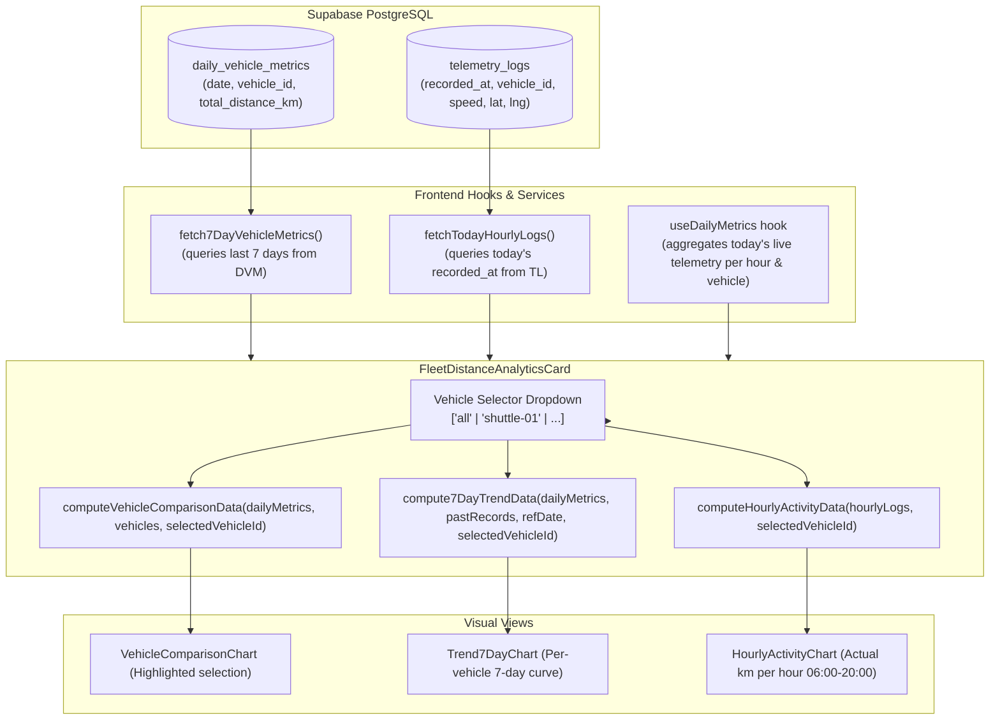

# Specification: Per-Vehicle Analytics & 7-Day Historical Data Engine

**Date:** 2026-11-06  
**Status:** Approved  
**Author:** Pair Programming Agent & User  
**Target Module:** `frontend/src/components/FleetDistanceAnalyticsCard.tsx`, `frontend/src/services/analyticsCalculator.ts`, `frontend/src/hooks/useDailyMetrics.ts`

---

## 1. Background & Problem Statement

In the previous sprint, `FleetDistanceAnalyticsCard` was implemented to display fleet-wide distance analytics across three views:
1. **Vehicle Comparison** (`VehicleComparisonChart`)
2. **7-Day Trend** (`Trend7DayChart`)
3. **Hourly Activity** (`HourlyActivityChart`)

During operational testing on 2026-11-06, two core issues and architectural gaps were discovered:

1. **Missing 7-Day Historical Data (Root Cause Bug):**
   - The 7-Day Trend chart rendered flat zeroes across all historical days even though actual test telemetry was successfully recorded on 2026-11-05 (`shuttle-01`: 4.91 km, 15 active minutes).
   - Investigation identified that `FleetDistanceAnalyticsCard.tsx` hardcoded an empty array `[]` as the second argument to `compute7DayTrendData(dailyMetrics, [], ...)`. No network query was being executed against Supabase `daily_vehicle_metrics` to retrieve past daily rollups.

2. **Fleet-Wide Aggregation vs. Per-Vehicle Operational Need:**
   - In campus shuttle and fleet management operations, lumping all shuttles into a single combined aggregate obscures individual vehicle health, maintenance requirements (e.g. tire wear, oil changes, EV battery cycles), and route shift balance.
   - The user expressed clear operational intent: *"I don't know why we aggregate all vehicles together... accumulated volume and hourly activity should be shown per vehicle to be actionable."*
   - The hourly activity chart currently utilizes a static synthetic bell-curve formula rather than actual hourly distance logged per vehicle.

---

## 2. Goals & Non-Goals

### Goals
* **Real 7-Day History Fetching:** Query Supabase table `daily_vehicle_metrics` for the past 7 days (`date >= CURRENT_DATE - 6 days`) so actual historical records (including 2026-11-05: 4.91 km) render immediately.
* **Header Vehicle Selector:** Add an intuitive Vehicle Filter Dropdown (`ทุกคัน (รวมกองรถ)` + individual vehicle IDs) to the card header.
* **Per-Vehicle 7-Day Trend:** When a specific vehicle is selected (e.g. `shuttle-01`), the 7-day chart plots that vehicle's daily mileage. When "ทุกคัน" is selected, it sums all vehicles per day.
* **Per-Vehicle Hourly Activity:** Keep the vertical bar chart design (06:00 - 20:00), but calculate real hourly distance for the selected vehicle (using `telemetry_logs` and live in-memory telemetry for today).
* **Comparison Highlighting:** In the "เปรียบเทียบรายคัน" tab, visibly highlight the selected vehicle's bar and ranking.
* **Zero Regressions:** Maintain 100% test pass rate across existing 190 tests and add new tests for vehicle selection and historical data calculation.

### Non-Goals
* Re-implementing the map or historical trip GPS replay (already functional in `HistoricalTripReplay.tsx`).
* Modifying database schemas (existing `daily_vehicle_metrics` and `telemetry_logs` tables already store all necessary data).

---

## 3. Architecture & Data Flow



---

## 4. Detailed Component & Service Specifications

### 4.1 Data Fetching Service (`historicalTelemetryService.ts`)
* Add `fetch7DayVehicleMetrics(referenceDate: Date = new Date())`:
  * Computes `startDate` = 6 days prior to `referenceDate` in `Asia/Bangkok` timezone.
  * Queries Supabase `daily_vehicle_metrics`:
    ```typescript
    supabase
      .from('daily_vehicle_metrics')
      .select('vehicle_id, date, total_distance_km, max_speed_kmh, avg_speed_kmh, active_minutes')
      .gte('date', startDateStr)
      .lte('date', todayStr)
      .order('date', { ascending: true });
    ```
  * Returns an array of daily vehicle metric records.

* Add `fetchHourlyDistanceRecords(dateStr: string, vehicleId?: string)`:
  * Queries `telemetry_logs` for `recorded_at` between start-of-day and end-of-day in Bangkok time.
  * Filters by `vehicleId` if specified.
  * Computes Haversine distance between consecutive points grouped into Bangkok hours `0` to `23`.
  * Returns `Record<string, Record<number, number>>` (`vehicle_id -> { hour: distanceKm }`).

### 4.2 Analytics Calculator (`analyticsCalculator.ts`)

#### `compute7DayTrendData`
```typescript
export interface DailyRecordItem {
  vehicle_id: string;
  date: string;
  total_distance_km: number;
}

export function compute7DayTrendData(
  dailyMetrics: DailyMetricsMap,
  pastDailyRecords: DailyRecordItem[] = [],
  referenceDate: Date = new Date(),
  selectedVehicleId?: string | null
): TrendDayPoint[]
```
* **Filtering Logic:**
  * If `selectedVehicleId` is provided and not `'all'`:
    * Filters `pastDailyRecords` to only rows where `row.vehicle_id === selectedVehicleId`.
    * For today's point (`isToday === true`), uses `dailyMetrics[selectedVehicleId]?.total_distance_km || 0`.
  * If `selectedVehicleId` is `'all'` or omitted:
    * Groups `pastDailyRecords` by `date` and sums `total_distance_km` across all vehicles.
    * For today's point, sums `total_distance_km` across all vehicles in `dailyMetrics`.
* **Zero / Flatline handling:**
  * Uses the real numbers from `pastDailyRecords`. Removes fake sine-wave generation when database connectivity is present.

#### `computeHourlyActivityData`
```typescript
export function computeHourlyActivityData(
  hourlyLogs: Record<string, Record<number, number>>, // vehicle_id -> hour -> km
  selectedVehicleId?: string | null,
  liveHourlyIncrements?: Record<string, Record<number, number>>
): HourlyActivityPoint[]
```
* Aggregates distance per hour for hours `6` through `20`.
* For `selectedVehicleId`: uses that vehicle's hourly sum.
* For `'all'`: sums all vehicles for each hour.
* Calculates `intensity` based on maximum hourly distance observed.

### 4.3 UI Component (`FleetDistanceAnalyticsCard.tsx`)

#### Header Controls:
* **Vehicle Selector Dropdown / Menu:**
  * Placed adjacent to the expand/collapse button in the header.
  * Options:
    * `🚐 ทุกคัน (รวมกองรถ)`
    * `🚌 shuttle-01`
    * `🚌 shuttle-cm-01`
    * *(Dynamically populated from available vehicles in `vehicles`, `dailyMetrics`, and `pastRecords`)*.
* **Contextual Subtitles:**
  * When `selectedVehicleId === 'all'`:
    * Trend subtitle: "ปริมาณระยะทางสะสมของกองรถ (กม./วัน)"
    * Hourly subtitle: "ความหนาแน่นการวิ่งรวมตลอดวัน (06:00 - 20:00)"
  * When `selectedVehicleId === 'shuttle-01'`:
    * Trend subtitle: "ปริมาณระยะทางสะสมของ shuttle-01 (กม./วัน)"
    * Hourly subtitle: "ระยะทางวิ่งจริงรายชั่วโมงของ shuttle-01"

#### Tab Visualizations:
* **`Trend7DayChart.tsx`:**
  * Plots 7 days with actual points and labels.
  * Displays highest recorded day in green badge (`สูงสุด: X.X km`).
* **`HourlyActivityChart.tsx`:**
  * Renders vertical bars for hours `06:00` to `20:00`.
  * Morning peak (07:00-09:00) and evening peak (16:00-18:00) retain amber accent when distance > 0.
  * Empty hours show minimal baseline bar with 0.0 km tooltip.
* **`VehicleComparisonChart.tsx`:**
  * Adds visual highlight border / background badge to the selected vehicle's bar.

---

## 5. Mobile Ergonomics & Responsiveness

* **Mobile Breakpoints (<640px):**
  * Vehicle selector collapses into a compact select dropdown with icon and full tap target (`min-h-[42px]`).
  * Header layout stacks gracefully: Title on top, vehicle selector and collapse button on the right/bottom row.
* **Desktop (>1024px):**
  * Flex-row header with ample spacing, smooth dropdown transition, and accessible keyboard focus outlines.

---

## 6. Testing & Quality Assurance Plan

1. **Unit Tests (`analyticsCalculator.test.ts`):**
   - Test `compute7DayTrendData` with `selectedVehicleId = 'shuttle-01'` vs `'all'`.
   - Verify historical values (e.g. 4.91 km on 2026-11-05) map correctly to past date points.
   - Test `computeHourlyActivityData` with specific vehicle hourly distribution.
2. **Component Tests (`FleetDistanceAnalyticsCard.test.tsx`):**
   - Verify Vehicle Selector renders options correctly.
   - Verify switching vehicle triggers chart re-render with vehicle-specific data.
   - Verify 7-day trend displays non-zero values for past records.
3. **Regression Tests:**
   - Run Vitest suite across all 29 test files to guarantee 0 regressions against existing 190 tests.
